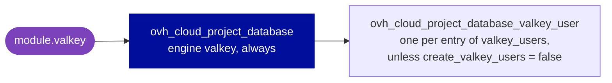

# terraform-ovh-valkey

[](CHANGELOG.md)
[](#requirements)
[](https://registry.terraform.io/providers/ovh/ovh/latest)
[](LICENSE)

**A Valkey database, the Redis-compatible engine, on OVHcloud Public Cloud in
one module block: the database, its nodes, IP restrictions and users.**

- 🧩 **The provider, unchanged.** Every input keeps its provider attribute
  name, but `valkey_version`: Terraform reserves `version`. If you know
  `ovh/ovh`, you already know this module.
- 🛡️ **Protected by default.** Deletion protection is on unless you turn it
  off, where the provider leaves a database unprotected.
- 🔒 **Public or private.** Nodes on the public network or in a private
  network (vRack), and the IP blocks allowed to connect.
- 👤 **Users with their ACL.** One entry per user, with its categories,
  channels, commands and keys, and its password as an output.

> [!IMPORTANT]
> Destroying the module, or changing `service_name` or the `region` of the
> nodes, deletes the database and its data once deletion protection is off.
> Read [Watch out](#watch-out) before your first apply.

**[Quick start](#quick-start)** · **[Inputs](#inputs)** ·
**[Outputs](#outputs)** · **[Watch out](#watch-out)** ·
**[Guides](#guides)** · **[Requirements](#requirements)**

## Quick start

**1. Create API credentials** for your OVHcloud account, able to manage the
Public Cloud project of the database, and export them with the API endpoint,
such as `ovh-eu`:

```bash
export OVH_ENDPOINT=ovh-eu OVH_CLIENT_ID=... OVH_CLIENT_SECRET=...
```

The provider also takes an application key, an application secret and a
consumer key, in `OVH_APPLICATION_KEY`, `OVH_APPLICATION_SECRET` and
`OVH_CONSUMER_KEY`, instead of the OAuth2 client.

**2. Call the module:**

```hcl
module "valkey" {
  source = "git::https://github.com/theobs-digital/terraform-ovh-valkey.git?ref=v2.0.0"

  service_name   = "your-ovh-project-id"  # the Public Cloud project ID
  valkey_version = "8.1"
  plan           = "discovery"
  flavor         = "b3-8"

  nodes = [
    { region = "GRA" },
  ]

  # The IP blocks authorized to access the database: without one, it is unreachable.
  ip_restrictions = [
    { ip = "203.0.113.10/32", description = "Workstation" },
  ]

  valkey_users = {
    app = { categories = ["+@all"], channels = ["*"], commands = ["+@all"], keys = ["*"] }
  }
}

output "valkey_endpoints" {
  value = module.valkey.valkey_endpoints
}

output "valkey_password" {
  value     = module.valkey.valkey_users["app"].password
  sensitive = true
}
```

**3. Apply, then connect** to the `uri` of an endpoint, as the user `app`.
Terraform prints its password, a sensitive output, when you name it:

```bash
terraform output valkey_endpoints
terraform output -raw valkey_password
```

> [!TIP]
> `?ref=v2.0.0` pins the module to its release `v2.0.0`. Always set `ref` to
> a tag: without it, Terraform takes the latest commit of the default branch.

More in the examples: [basic](examples/basic) (one node on the public
network, no user), [complete](examples/complete) (two nodes in a private
network, backups, an advanced setting, an IP restriction and two users) and
[import](examples/import) (an existing database brought under the module).

### How it works

Each input drives one provider resource, or a block of the database. Leave
an input out, and the module creates nothing for it.



`nodes` and `ip_restrictions` are blocks of the database.

### Design decisions

The module is for OVHcloud only, and intentionally opinionated: deletion
protection on by default, and Valkey only, to avoid an unsafe abstraction
over every database engine. Creating the network is out of scope: a
dedicated network module handles it. The module is designed to be
orchestrated by higher-level tools, such as Ansible.

## Inputs

| Input | Type | Default | Description |
|---|---|---|---|
| `service_name` | `string` | **required** | ID of the Public Cloud project |
| `valkey_version` | `string` | **required** | Valkey version, `X.Y`, such as `8.1` |
| `plan` | `string` | **required** | plan of the database, such as `discovery` or `production` |
| `flavor` | `string` | **required** | flavor of the nodes, such as `b3-8` |
| `nodes` | `list(object)` | **required** | the nodes, see [Nodes](#nodes) |
| `description` | `string` | `null` | description of the database |
| `deletion_protection` | `bool` | `true` | refuse to delete the database |
| `backup_regions` | `list(string)` | `null` | regions the backups go to |
| `advanced_configuration` | `map(string)` | `null` | advanced Valkey parameters, such as `valkey_maxmemory_policy` |
| `ip_restrictions` | `list(object)` | `null` | IP blocks authorized to connect, see [IP restrictions](#ip-restrictions) |
| `create_valkey_users` | `bool` | `true` | `false` creates none of `valkey_users` |
| `valkey_users` | `map(object)` | `{}` | users and their ACL, by name, see [Users](#users) |

Each block below lists every attribute an input takes, with what it does.
Attributes keep their provider names, and whatever you leave out keeps
OVHcloud's default, but `deletion_protection`, which the module turns on.

> [!WARNING]
> **A misspelled attribute is dropped without a word.** Terraform discards
> the attributes an object input does not declare: `descripton = "Office"`
> leaves the IP restriction without a description, and the plan shows no
> error. Check the names against the blocks on this page.

### Database

```hcl
# Required.
service_name   = "your-ovh-project-id"  # changing it replaces the database
valkey_version = "8.1"                  # X.Y
plan           = "production"           # such as discovery, one node, or production, two nodes
flavor         = "b3-8"                 # changing it moves the nodes to the new flavor

# Optional. deletion_protection shows the module's default.
description            = "Production Valkey cluster"
deletion_protection    = true     # set false, and apply, before a destroy
backup_regions         = ["GRA"]  # at most two, one of them the region of the nodes
advanced_configuration = { valkey_maxmemory_policy = "allkeys-lru" }
```

**`valkey_version`** takes `X.Y`, as OVHcloud lists Valkey versions, such as
`8.1`: the provider takes any string, so the module refuses any other format
at plan, such as `latest`.

**`plan`**: OVHcloud offers two plans for Valkey, according to its
[capabilities page](https://docs.ovhcloud.com/en/guides/public-cloud/databases/valkey-capabilities) of 13 October 2026:
`discovery`, one node, whose backups are kept 1 day, and `production`, two
nodes, a primary and a replica, whose backups are kept 3 days. The
provider's documentation still lists `essential` and `business`, which the
page no longer names.

**`deletion_protection`** is on unless you set it to `false`: the provider
leaves a database unprotected when it is unset. To destroy the database,
set it to `false` and apply first.

The module has neither `disk_size` nor `backup_time`: OVHcloud resizes
storage only for the engines that use it, and lets the backup time be set
only for MongoDB, MySQL and PostgreSQL. Valkey is backed up every 12 hours.

### Nodes

`nodes` lists as many nodes as the plan requires, such as one for
`discovery` and two for `production`. They must be identical: a database
spans one region only.

```hcl
nodes = [
  {
    region     = "GRA"                                   # required; changing it replaces the database
    network_id = "xxxxxxxx-xxxx-xxxx-xxxx-xxxxxxxxxxxx"  # the private network; left out: the public network
    subnet_id  = "yyyyyyyy-yyyy-yyyy-yyyy-yyyyyyyyyyyy"  # a subnet of that network
  },
  {
    region     = "GRA"
    network_id = "xxxxxxxx-xxxx-xxxx-xxxx-xxxxxxxxxxxx"
    subnet_id  = "yyyyyyyy-yyyy-yyyy-yyyy-yyyyyyyyyyyy"
  },
]
```

`network_id` is the OpenStack ID of the private network (vRack) in the
region of the nodes, not its `pn-…` ID: with
`ovh_cloud_project_network_private`, the `openstackid` of that region in
`regions_attributes`, which `regions_openstack_ids` also gives by region. A
network names its regions as OpenStack does, such as `GRA11`, and a database
as `GRA`, and OVHcloud does not document how they match: choose the region
of the network yourself. The module creates no network: a dedicated network
module, or another configuration, provides it. `network_id` and `subnet_id` change in place,
without replacing the database, but OVHcloud rebuilds it, see
[Watch out](#watch-out).

### IP restrictions

```hcl
ip_restrictions = [
  { ip = "10.0.0.0/24", description = "Internal network" },
]
```

The IP blocks authorized to access the database, each with an optional
description. Leave the input out, and the module sends none: the database is
then unreachable, since OVHcloud lets no traffic in until an IP block is
authorized ("Until then, your service will be unreachable", section
Authorised IPs of the [capabilities page](https://docs.ovhcloud.com/en/guides/public-cloud/databases/valkey-capabilities)).

### Users

```hcl
create_valkey_users = true  # false: the module creates none of valkey_users

valkey_users = {
  app-rw = {  # the user's name; changing it replaces the user
    categories = ["+@all"]
    channels   = ["*"]
    commands   = ["+@all"]
    keys       = ["app:*"]
  }
  monitoring = {
    categories = ["+@all"]
    channels   = ["*"]
    commands   = ["+@read"]
    keys       = ["*"]
  }
}
```

The key of `valkey_users` is the user's name: [renaming it](#rename-a-key)
replaces the user. The module takes all four lists of the ACL, and not the
provider's `password_reset`. OVHcloud generates each password, which the
sensitive output `valkey_users` gives, such as
`module.valkey.valkey_users["app-rw"].password`.

## Outputs

| Output | Use it for |
|---|---|
| `valkey_endpoints` | 👉 the clients: the `uri`, `domain`, `port` and SSL mode of each endpoint |
| `valkey_users` | 👉 the clients: the `password` of each user, by key of `valkey_users`, sensitive |
| `valkey_id` | the resources, imports and OVHcloud API calls that act on the database |
| `valkey_engine` | `valkey`, as the import ID names the engine |
| `valkey_version` | the Valkey version of the database |
| `valkey_nodes` | the region and network of each node |
| `valkey_status` | the current status of the database |

> [!NOTE]
> Terraform keeps the passwords of the users in the state in clear text, as
> every sensitive value: protect the backend.

## Watch out

**🔴 Can delete data or lock clients out**

- **Destroying the module, or changing `service_name` or the `region` of the
  nodes**, deletes the database and its data, once `deletion_protection` is
  `false`; a change then creates a new database. Before applying, look for
  `module.valkey.ovh_cloud_project_database.this` in the plan.
- **Changing the network of the nodes** rebuilds the database: it goes
  through `UPDATING` and `REBUILDING` before `RUNNING`, may be unavailable
  meanwhile, and loses its IP restrictions, which no longer match the new
  network.
- **Renaming a key of `valkey_users`** replaces the user, with a new
  password: its clients can no longer log in. See [Rename a key](#rename-a-key).
- **A key `default` in `valkey_users`** does not create a user: it takes
  over the existing default user and resets its password.
- **Removing a key of `valkey_users`, or setting `create_valkey_users =
  false`**, deletes those users.

**🟠 Surprises at apply**

- **A database without `ip_restrictions`** is created, but unreachable:
  OVHcloud lets no traffic in until an IP block is authorized. See
  [IP restrictions](#ip-restrictions).
- **A destroy with `deletion_protection = true`**, the default, fails: set it
  to `false` and apply first.
- **`backup_regions`** takes at most two regions, one of them the region of
  the nodes.
- **Nodes in different regions**: the database spans one region only, with
  identical nodes.
- **A misspelled attribute**, such as `descripton`, is dropped without an
  error: the apply goes ahead without it. See [Inputs](#inputs).

## Guides

### Adopt existing resources

To bring an existing database under the module, declare it with the inputs it
has, then import each of its objects, as the [import example](examples/import)
does, with these IDs:

| Resource | Import ID |
|---|---|
| `module.valkey.ovh_cloud_project_database.this` | `<service_name>/valkey/<database ID>` |
| `module.valkey.ovh_cloud_project_database_valkey_user.user["<name>"]` | `<service_name>/<database ID>/<user ID>` |

```hcl
import {
  to = module.valkey.ovh_cloud_project_database.this
  id = "your-ovh-project-id/valkey/xxxxxxxx-xxxx-xxxx-xxxx-xxxxxxxxxxxx"
}
```

Write each input as the database has it, and key each user by its current
name: a different `region` of the nodes plans a replacement. Apply only a
plan that imports and destroys nothing: look for `must be replaced` in it.
`import` blocks need Terraform 1.5 or later, and 1.6 to take variables in
`id`; before, run `terraform import` with the same address and ID.

### Move resources into the module

When your configuration already manages the database as its own resources,
such as `resource "ovh_cloud_project_database" "valkey"`, replacing them
with the module makes the plan destroy each object and create it again.
Declare each move instead, from the resource to its place in the module:

```hcl
moved {
  from = ovh_cloud_project_database.valkey
  to   = module.valkey.ovh_cloud_project_database.this
}

moved {
  from = ovh_cloud_project_database_valkey_user.app
  to   = module.valkey.ovh_cloud_project_database_valkey_user.user["app"]
}
```

A user moves to the key of its current name. The plan then shows each move;
a change in it is an input written differently from the resource. Once every
state of the configuration has applied them, the `moved` blocks can go.

### Rename a key

The key of `valkey_users` is the user's name, and the provider replaces a
user whose name changes: a `moved` block cannot avoid it. To rename a user
without cutting its clients off, add one under the new key and apply, move
the clients to its password, then remove the old key and apply.

### Stop managing without deleting

**The whole module.** Remove the `module` block and declare its removal
(Terraform 1.7 or later). The plan then shows each object as "will no longer
be managed by Terraform, but will not be destroyed". Before Terraform 1.7,
run `terraform state rm module.valkey` instead.

```hcl
removed {
  from = module.valkey

  lifecycle {
    destroy = false
  }
}
```

**One user.** A `removed` block cannot target one key of `valkey_users`:
forget it with `terraform state rm`, then remove its entry.

```bash
terraform state rm 'module.valkey.ovh_cloud_project_database_valkey_user.user["monitoring"]'
```

### Delete the database

1. Set `deletion_protection = false` and apply.
2. Destroy the module, or remove it from the configuration and apply.

## Requirements

| | Version | Checked with |
|---|---|---|
| Terraform | `>= 1.3` | 1.3.10 and 1.16.5 |
| Provider [`ovh/ovh`](https://registry.terraform.io/providers/ovh/ovh/latest) | `~> 2.8`, the first with the `deletion_protection` attribute of `ovh_cloud_project_database` | 2.8.0 and 2.22.0 |

`import` blocks need Terraform 1.5 or later, the
[import example](examples/import) 1.6, and `removed` blocks 1.7. The provider
reads the API endpoint from `OVH_ENDPOINT`, and the credentials from
`OVH_CLIENT_ID` and `OVH_CLIENT_SECRET`, or from `OVH_APPLICATION_KEY`,
`OVH_APPLICATION_SECRET` and `OVH_CONSUMER_KEY`, see
[Quick start](#quick-start).

## Reference

<details>
<summary><b>Every input and output, with its full type</b> (generated by terraform-docs)</summary>

<!-- BEGIN_TF_DOCS -->
### Resources

The following resources are used by this module:

- [ovh_cloud_project_database.this](https://registry.terraform.io/providers/ovh/ovh/latest/docs/resources/cloud_project_database) (resource)
- [ovh_cloud_project_database_valkey_user.user](https://registry.terraform.io/providers/ovh/ovh/latest/docs/resources/cloud_project_database_valkey_user) (resource)

### Required Inputs

The following input variables are required:

#### <a name="input_flavor"></a> [flavor](#input\_flavor)

Description: Valkey flavor, such as `b3-8`.

Type: `string`

#### <a name="input_nodes"></a> [nodes](#input\_nodes)

Description: Valkey nodes, as many as the plan requires, such as 1 for `discovery` and 2 for `production`.

Type:

```hcl
list(object({
    region     = string
    network_id = optional(string)
    subnet_id  = optional(string)
  }))
```

#### <a name="input_plan"></a> [plan](#input\_plan)

Description: Valkey plan, such as `discovery` or `production`.

Type: `string`

#### <a name="input_service_name"></a> [service\_name](#input\_service\_name)

Description: OVH project service name (project ID).

Type: `string`

#### <a name="input_valkey_version"></a> [valkey\_version](#input\_valkey\_version)

Description: Valkey engine version, such as `8.1` or `9.1`.

Type: `string`

### Optional Inputs

The following input variables are optional (have default values):

#### <a name="input_advanced_configuration"></a> [advanced\_configuration](#input\_advanced\_configuration)

Description: Advanced Valkey parameters of OVHcloud, such as `valkey_maxmemory_policy`.

Type: `map(string)`

Default: `null`

#### <a name="input_backup_regions"></a> [backup\_regions](#input\_backup\_regions)

Description: List of regions where backups are stored.

Type: `list(string)`

Default: `null`

#### <a name="input_create_valkey_users"></a> [create\_valkey\_users](#input\_create\_valkey\_users)

Description: Whether the module creates Valkey users.

Type: `bool`

Default: `true`

#### <a name="input_deletion_protection"></a> [deletion\_protection](#input\_deletion\_protection)

Description: Whether deletion protection is enabled.

Type: `bool`

Default: `true`

#### <a name="input_description"></a> [description](#input\_description)

Description: Description of the Valkey database.

Type: `string`

Default: `null`

#### <a name="input_ip_restrictions"></a> [ip\_restrictions](#input\_ip\_restrictions)

Description: List of IP restrictions for Valkey access.

Type:

```hcl
list(object({
    ip          = string
    description = optional(string)
  }))
```

Default: `null`

#### <a name="input_valkey_users"></a> [valkey\_users](#input\_valkey\_users)

Description: Valkey users with their ACL, by name: the key is the user's `name`, so renaming a key replaces the user.

Type:

```hcl
map(object({
    categories = list(string)
    channels   = list(string)
    commands   = list(string)
    keys       = list(string)
  }))
```

Default: `{}`

### Outputs

The following outputs are exported:

#### <a name="output_valkey_endpoints"></a> [valkey\_endpoints](#output\_valkey\_endpoints)

Description: Endpoints of the database, each with its `component`, `domain`, `path`, `port`, `scheme`, `ssl`, `ssl_mode` and `uri`, to connect the clients.

#### <a name="output_valkey_engine"></a> [valkey\_engine](#output\_valkey\_engine)

Description: Engine of the database, always `valkey`, as the import ID and the OVHcloud API name it.

#### <a name="output_valkey_id"></a> [valkey\_id](#output\_valkey\_id)

Description: ID of the Valkey database, for the resources, imports and API calls that act on it.

#### <a name="output_valkey_nodes"></a> [valkey\_nodes](#output\_valkey\_nodes)

Description: Configuration of the nodes, with their `region`, `network_id` and `subnet_id`, to see where they run.

#### <a name="output_valkey_status"></a> [valkey\_status](#output\_valkey\_status)

Description: Current status of the database, to check it before connecting clients.

#### <a name="output_valkey_users"></a> [valkey\_users](#output\_valkey\_users)

Description: Valkey users created by the module, by key of `valkey_users`, with their `password`, for the clients that log in as them.

#### <a name="output_valkey_version"></a> [valkey\_version](#output\_valkey\_version)

Description: Valkey version of the database, for the clients that depend on it.
<!-- END_TF_DOCS -->

</details>

## Development

### Tools

| Tool | Version checked | Used for |
|---|---|---|
| [Terraform](https://developer.hashicorp.com/terraform/install) | 1.16.5 | fmt, validate and `terraform test` |
| [TFLint](https://github.com/terraform-linters/tflint) | 0.64.0 | lint, with `.tflint.hcl` |
| [terraform-docs](https://terraform-docs.io/user-guide/installation/) | 0.24.0 | the [Reference](#reference), generated between the `BEGIN_TF_DOCS` and `END_TF_DOCS` markers, with `.terraform-docs.yml` |
| [pre-commit](https://pre-commit.com/#install) | 4.5.1 | runs the hooks of `.pre-commit-config.yaml` |

The tests use `mock_provider`, which takes Terraform 1.7 or later; callers of
the module only need the version of [Requirements](#requirements).

### Checks

Install the hooks once per clone, so that fmt, validate, tflint and
terraform-docs run on each commit:

```bash
pre-commit install
```

Before pushing, run the hooks on every file, then the tests, which are not a
hook. They mock the provider, and need no OVHcloud credentials:

```bash
pre-commit run --all-files
terraform init -backend=false
terraform test
```

The [Checks](.github/workflows/checks.yml) workflow runs the same, on each
pull request and each push to `main`, and a second job validates the module
and its `basic` and `complete` examples with Terraform 1.3.10 and provider
2.8.0, the bottom of the requirements.

### Real API tests

The mock tests cannot see what OVHcloud does with a value. `tests-real` is a
configuration that calls the module: a Valkey database `tf-test-ci-valkey`
on plan `discovery`, with one `b3-8` node in `GRA` and the user
`tf-test-ci`, its deletion protection off. Apply it, plan it again, which
must show no change, then destroy it.

```bash
cd tests-real
export OVH_ENDPOINT=ovh-eu OVH_APPLICATION_KEY=... OVH_APPLICATION_SECRET=... OVH_CONSUMER_KEY=...
export TF_VAR_service_name=... TF_VAR_valkey_version=8.1
terraform init
terraform apply
terraform plan -detailed-exitcode
terraform destroy
```

A second plan with a change is a provider that drifts from what it applied.
The [Real API tests](.github/workflows/tests-real.yml) workflow runs the
same on demand, from the Actions tab, and destroys the database even when a
step fails. Its weekly schedule, on Mondays at 05:00 UTC,
stays commented out until the test project and these repository secrets
exist:

| Secret | Value |
|---|---|
| `OVH_ENDPOINT` | the API endpoint, such as `ovh-eu` |
| `OVH_APPLICATION_KEY`, `OVH_APPLICATION_SECRET`, `OVH_CONSUMER_KEY` | the credentials of the test project |
| `TEST_SERVICE_NAME` | the ID of the test Public Cloud project |
| `TEST_VALKEY_VERSION` | a Valkey version that OVHcloud offers, such as `8.1` |

A destroy that fails leaves the database `tf-test-ci-valkey` behind: delete
it by hand. The workflow has no cleanup step, since each call to the
OVHcloud API is signed.

### Release

Update `CHANGELOG.md`, then tag the commit and push the tag:

```bash
git tag -a vX.Y.Z -m "terraform-ovh-valkey vX.Y.Z"
git push origin vX.Y.Z
```

The [Release](.github/workflows/release.yml) workflow then creates the
GitHub release of the tag, with its section of the `CHANGELOG.md` as notes.
